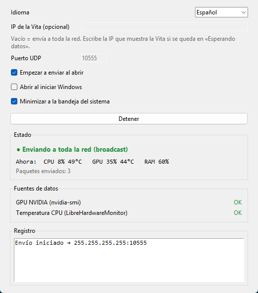

# VitaMon: monitor de PC en la PS Vita

Convierte tu PS Vita en una pantalla de monitoreo para tu PC con Windows: CPU (total y por hilo), GPU, temperaturas, RAM, red y disco, con gráficas de los últimos 60 segundos.

El PC envía sus datos por la red WiFi una vez por segundo y la Vita los muestra a pantalla completa. No hace falta cable ni configurar IPs: basta con que los dos estén en la misma red.

**Idiomas:** español, English, português, français, Deutsch, italiano (en la Vita y en el programa del PC).

[English](README.md) · **Español**

---

## Inicio rápido

> **Beta:** VitaMon está en beta pública. Si algo no funciona, [abre un issue](https://github.com/MrWhite2312-IS/VitaPCMonitor/issues) con el firmware de tu Vita, tu versión de Windows y tu GPU.

Necesitas:

- Una PS Vita con **HENkaku/Ensō** y **VitaShell**.
- Un PC con **Windows 10/11** en la misma red WiFi/Ethernet que la Vita.

### 1. Instala la app en la Vita

1. Descarga `VitaMon.vpk` de la [última versión](https://github.com/MrWhite2312-IS/VitaPCMonitor/releases) (o [compílalo](#compilar-la-app-de-la-vita)).
2. Pásalo a la Vita con VitaShell:
   - **Por WiFi (FTP):** en VitaShell pulsa SELECT. Abre en el explorador del PC la dirección `ftp://IP:1337` que aparece en la Vita y copia el VPK a `ux0:data/`.
   - **Por USB:** en VitaShell pulsa START → *USB connection* y copia el VPK a la unidad que aparece en el PC.
3. En VitaShell busca el VPK, pulsa ✕ y confirma la instalación. Aparece **VitaMon** en el menú de inicio.

### 2. Abre VitaMon en el PC

1. Descarga `VitaMon.exe` de la [última versión](https://github.com/MrWhite2312-IS/VitaPCMonitor/releases) (o genéralo con [build_exe.bat](#generar-vitamonexe)). Ponlo en cualquier carpeta; no necesita instalación. Si tu antivirus protesta, descarga en su lugar `VitaMon-windows.zip` (la misma app en carpeta), descomprímelo y mantén toda la carpeta `VitaMon` junta.
2. Haz doble clic en `VitaMon.exe`. Se abre una ventana y empieza a enviar datos solo.
3. La primera vez Windows pregunta si permite el acceso a la red: marca **Redes privadas** y acepta.



| En la ventana | Para qué sirve |
|---------------|----------------|
| **Idioma** | Cambia el idioma de la ventana. |
| **IP de la Vita** | Déjalo vacío. Solo hace falta si la Vita no recibe nada (ver [problemas](#problemas-frecuentes)). |
| **Iniciar / Detener** | Empieza o para el envío. |
| **Empezar a enviar al abrir** | Si está marcado, no hace falta pulsar Iniciar. |
| **Abrir al iniciar Windows** | Abre VitaMon minimizado al encender el PC y empieza a enviar. |
| **Fuentes de datos** | Muestra si se pueden leer la GPU y la temperatura de la CPU, y qué hacer si no. |

La configuración se guarda en `%APPDATA%\VitaMon\config.json`.

### 3. Abre VitaMon en la Vita

En unos segundos el estado pasa de **Esperando** a **Conectado** y aparecen los datos.

| Botón | Acción |
|-------|--------|
| SELECT | Cambiar idioma (se recuerda para la próxima vez) |
| □ | Vista compacta: CPU %, CPU °C, GPU %, GPU °C en grande |
| △ | Datos de depuración (última línea recibida, paquetes/s, IPs) |
| START | Salir |

La primera vez la app usa el idioma del sistema de la Vita (o inglés si no está disponible). El idioma elegido con SELECT se guarda en `ux0:data/VitaMon/lang.txt`.

Estados en la esquina superior: **Esperando** (no ha llegado nada; muestra la IP de la Vita), **Conectado** y **Sin señal** (más de 3 s sin datos; los últimos valores se ven atenuados).

---

## Datos opcionales

CPU, RAM, red y disco funcionan siempre. Dos datos necesitan algo más:

### Temperatura de la CPU: LibreHardwareMonitor

Windows no da la temperatura de la CPU a programas normales, así que VitaMon la lee de [LibreHardwareMonitor](https://github.com/LibreHardwareMonitor/LibreHardwareMonitor):

1. Descárgalo y ábrelo **como administrador** (clic derecho → *Ejecutar como administrador*).
2. Activa *Options → Remote Web Server → Run* (puerto 8085).
3. Comprueba que `http://localhost:8085/data.json` abre en el navegador.

Sin esto, la temperatura de la CPU aparece como `--`.

### GPU: solo NVIDIA

La GPU se lee con `nvidia-smi`, que viene con el driver de NVIDIA. Con GPU AMD o Intel, o si `nvidia-smi` no está en el PATH, la GPU aparece como `--` (el nombre del modelo sí aparece; VitaMon reintenta cada 30 s).

---

## Problemas frecuentes

**La Vita se queda en "Esperando datos"**

1. Comprueba que el PC y la Vita están en la misma red (por ejemplo, los dos en `192.168.1.x`).
2. Comprueba que en Windows tu red está marcada como **Privada** (*Configuración → Red e Internet → Propiedades*).
3. Muchos routers bloquean el envío a toda la red (broadcast). Escribe en **IP de la Vita** la IP que aparece en la pantalla de espera de la Vita, pulsa **Detener** y luego **Iniciar**.
4. Si sigue sin llegar, permite VitaMon en el firewall. En PowerShell como administrador:

   ```powershell
   New-NetFirewallRule -DisplayName "VitaMon UDP" -Direction Outbound -Protocol UDP -RemotePort 10555 -Action Allow -Profile Private
   ```

**Temperatura de la CPU en `--`:** LibreHardwareMonitor no está abierto, no se abrió como administrador o el *Remote Web Server* está apagado.

**GPU en `--`:** no es una GPU NVIDIA o `nvidia-smi` no funciona. Prueba a ejecutar `nvidia-smi` en una terminal.

**"VitaMon ya está abierto":** ya hay una ventana de VitaMon (quizá minimizada en la barra de tareas). Solo puede haber una a la vez.

**Windows SmartScreen o el antivirus avisan al abrir el .exe:** el programa no tiene firma digital y los programas Python empaquetados con PyInstaller a veces dan falsos positivos. Pulsa *Más información → Ejecutar de todas formas*. La versión en carpeta (`VitaMon-windows.zip`) suele dar menos falsos positivos. También puedes ejecutarlo desde el código fuente (`pythonw vitamon_gui.py`).

---

## Para desarrolladores

```
server/   programa del PC (Python + psutil; ventana con tkinter)
vita/     app homebrew (C + VitaSDK + vita2d)
tools/    generador de los assets de LiveArea
```

### Generar VitaMon.exe

Requiere Python 3.10+ en el PATH. Desde la carpeta `server`:

```bat
build_exe.bat
```

Crea un entorno en `server\.venv-build`, instala psutil, PyInstaller y Pillow, y genera `server\dist\VitaMon.exe` (un solo archivo, sin consola, con el icono de la app) y `server\dist\VitaMon-windows.zip` (la misma app en carpeta).

GitHub Actions compila el VPK y el EXE en cada push. Al subir una etiqueta `v*` (por ejemplo `git tag v1.1.0 && git push origin v1.1.0`) los publica como *Release*.

### Usar el servidor desde la consola

La versión de consola sigue disponible y acepta las mismas opciones de antes:

```bat
cd server
pip install -r requirements.txt
python vitamon_server.py --verbose
```

Opciones: `--port 10555`, `--interval 1.0`, `--target IP_VITA`, `--lhm-url http://localhost:8085/data.json`, `--verbose`. `run_vitamon.bat` lo inicia con doble clic.

La ventana también se puede abrir sin compilar: `pythonw vitamon_gui.py` (opciones `--start` y `--minimized`).

### Compilar la app de la Vita

En macOS o Linux, instala VitaSDK con vdpm:

```bash
export VITASDK=$HOME/vitasdk
export PATH=$VITASDK/bin:$PATH
git clone https://github.com/vitasdk/vdpm
cd vdpm
./bootstrap-vitasdk.sh
vdpm install zlib libpng libjpeg-turbo libvita2d
```

Con `VITASDK` en tu carpeta personal no hace falta sudo. Solo se instalan los paquetes que usa VitaMon (el `install-all.sh` instala más de 100 y falla con el cliente pacman nuevo de vdpm). Agrega los dos `export` a tu `~/.zshrc` o `~/.bashrc`. También necesitas `cmake`.

```bash
cd vita && mkdir build && cd build && cmake .. && make
```

Eso produce `vita/build/VitaMon.vpk`.

Los assets de LiveArea ya están en `vita/sce_sys/`. Para regenerarlos: `pip install pillow && python tools/make_assets.py` (salen como PNG 8-bit indexados, que es lo que acepta la Vita).

### Agregar o corregir un idioma

- **Vita:** `vita/src/lang.c` (tabla `strings`) y el enum `Lang` en `vita/src/lang.h`. Mantén los `%s`/`%d` de cada texto; el test los comprueba. La fuente de la Vita dibuja letras latinas con acentos, pero no japonés, chino ni coreano.
- **PC:** el diccionario `STRINGS` y `LANGS` en `server/i18n.py`.

### Pruebas sin la Vita

```bash
# parser del protocolo
cd vita/tests && gcc -std=c11 -Wall -I../src ../src/protocol.c test_protocol.c -o test_protocol -lm && ./test_protocol

# traducciones: no falta ningún texto y los formatos coinciden
cd vita/tests && gcc -std=c11 -Wall -I../src ../src/lang.c test_lang.c -o test_lang && ./test_lang

# una línea real del servidor pasada por el parser C
cd server && python test_server_line.py

# ver lo que envía el PC (en otra terminal u otra máquina)
python server/test_listener.py
```

### Protocolo (v1)

Una línea ASCII por datagrama UDP (puerto 10555), menor a 1024 bytes:

```
VMON1;host=DESKTOP;cpun=Ryzen 5 5600G;gpun=RTX 3050;cpu=23.4;cores=12,30,...;ctemp=54.0;ram=55.1;ramu=8.8;ramt=16.0;gpu=12;gtemp=60;vramu=1.2;vramt=8.0;gclk=1500;up=123.4;down=456.7;disk=40.2;ts=1731258000
```

`-1` significa "no disponible". La app ignora claves desconocidas y cualquier datagrama que no empiece con `VMON1;`.


## Licencia

[MIT](LICENSE)
