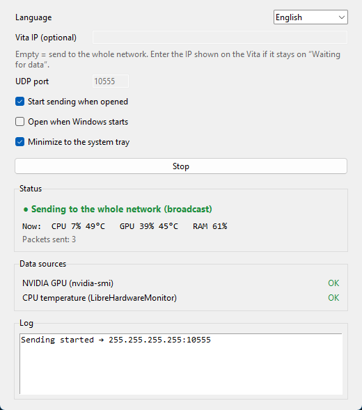

<div align="center">

# VitaMon

**Turn your PS Vita into a live hardware monitor for your Windows PC.**

CPU, GPU, temperatures, RAM, network and disk on the Vita's screen, updated every second over WiFi.

[](https://github.com/MrWhite2312-IS/VitaPCMonitor/actions/workflows/build.yml)
[](https://github.com/MrWhite2312-IS/VitaPCMonitor/releases)
[](LICENSE)

**English** · [Español](README.es.md)

</div>

<p align="center"></p>

## Features

- **CPU:** total load, a bar per thread, temperature and the CPU model name.
- **GPU (NVIDIA, AMD Radeon, Intel):** load, temperature, VRAM used/total and core clock.
- **Game FPS** of the game you're playing, with RivaTuner Statistics Server ([details](#game-fps-rivatuner)).
- **RAM, network** (upload/download KB/s) and **disk** activity.
- **60-second graphs** for CPU and GPU load and temperature.
- **Compact view** with big load and temperature numbers, color bars and mini graphs, readable from across the desk.
- **Touch screen:** tap to switch views, swipe to change language, hold for debug info.
- **Vita battery** level in the corner, and **easy on it:** the app only redraws when something changes and lets the Vita sleep when the PC is off.
- **Two-way connection:** the PC window tells you when the Vita is actually receiving (and its battery level).
- **No setup on the network side:** the PC broadcasts on your LAN and the Vita picks it up. No IPs to type in most cases.
- **Small Windows app with a window, not a console.** It can start with Windows, lives in the system tray and tells you when there's a new version.
- **6 languages** on both the Vita and the PC: English, Español, Português, Français, Deutsch, Italiano.
- **Your stats stay on your network:** they go from your PC to your Vita over UDP on your LAN. The only internet request is the update check (an anonymous request to GitHub's public API when the app opens), which you can turn off.

## Requirements

- A PS Vita (or PS TV) with **HENkaku / Ensō** and **VitaShell**.
- A **Windows 10/11** PC on the same network as the Vita (WiFi or Ethernet).
- Optional: **LibreHardwareMonitor** for CPU temperature (and GPU temperature on AMD/Intel), and **RivaTuner Statistics Server** for game FPS ([details](#optional-sensors)).

## Quick start

### 1. Download

> **Beta:** VitaMon is in public beta. If something doesn't work, please [open an issue](https://github.com/MrWhite2312-IS/VitaPCMonitor/issues) with your Vita firmware, Windows version and GPU.

Get both files from the [latest release](https://github.com/MrWhite2312-IS/VitaPCMonitor/releases) (the newest one at the top of the list):

| File | Goes on |
|------|---------|
| `VitaMon.vpk` | the PS Vita |
| `VitaMon.exe` | the Windows PC (single file) |
| `VitaMon-windows.zip` | the Windows PC: the same app as a folder, if your antivirus complains about the single `.exe` |

### 2. Install on the Vita

1. Copy `VitaMon.vpk` to the Vita with VitaShell:
   - **WiFi (FTP):** press SELECT in VitaShell, then open the `ftp://IP:1337` address it shows in your PC's file explorer and copy the VPK to `ux0:data/`.
   - **USB:** press START in VitaShell → *USB connection*, then copy the VPK to the drive that appears on the PC.
2. In VitaShell, select the VPK, press ✕ and confirm the install. **VitaMon** appears on the home screen.

### 3. Run on the PC

1. Put `VitaMon.exe` in any folder. It does not need to be installed. If you downloaded the `.zip`, extract it and keep the whole `VitaMon` folder together.
2. Double-click it. A small window opens and starts sending right away.
3. The first time, Windows asks about network access: allow it on **Private networks**.

<p align="center"></p>

| Option | What it does |
|--------|--------------|
| **Language** | Changes the window language. |
| **Vita IP** | Leave it empty. You only need it if the Vita gets nothing ([see below](#troubleshooting)). |
| **Start / Stop** | Starts or stops sending. |
| **Start sending when opened** | No need to press Start every time. |
| **Open when Windows starts** | Launches VitaMon minimized at login. |
| **Minimize to the system tray** | Minimizing hides the window and leaves an icon next to the clock. Click it to show the window; right-click for Start/Stop and Quit. |
| **Check for updates when opened** | Shows a banner at the top when a new version is out. Click it to open the download page. |
| **Status** | Whether it's sending, and whether the Vita is answering ("The Vita … is receiving the data", with its battery). |
| **Data sources** | Where the GPU, CPU-temperature and FPS data come from, and how to fix it if something is missing. |

Settings are saved in `%APPDATA%\VitaMon\config.json`.

### 4. Open VitaMon on the Vita

Within a couple of seconds the status changes from **Waiting** to **Connected** and the stats appear.

| Button | Touch | Action |
|--------|-------|--------|
| □ | Tap | Compact view: CPU and GPU load and temperature in big numbers, with bars and 60-second graphs |
| SELECT | Swipe left/right | Change language (remembered for next time) |
| △ | Hold | Debug overlay: last packet, packets/s, IP addresses |
| START | | Quit |

The first time, the app uses the Vita's system language (English if it isn't one of the six). The top bar shows the PC name, the game's **FPS** (when available), the Vita's **battery**, the connection status and the time. The status is **Waiting** (nothing received yet, with the Vita's IP), **Connected**, or **No signal** (no data for 3 s; the last values stay on screen, dimmed).

## Optional sensors

CPU load, RAM, network and disk always work. Some things need a bit more:

### CPU temperature: LibreHardwareMonitor

Windows does not expose CPU temperature to normal programs, so VitaMon reads it from [LibreHardwareMonitor](https://github.com/LibreHardwareMonitor/LibreHardwareMonitor):

1. Run LibreHardwareMonitor **as administrator**.
2. Enable *Options → Remote Web Server → Run* (port 8085).
3. Check that `http://localhost:8085/data.json` opens in your browser.

Without it, CPU temperature shows as `--`. The VitaMon window tells you whether it is detected.

### GPU: NVIDIA, AMD Radeon and Intel

VitaMon uses the best source it finds. The VitaMon window shows which one is in use:

| Source | Works with | Load | VRAM | Temperature | Clock |
|--------|-----------|:----:|:----:|:-----------:|:-----:|
| `nvidia-smi` (comes with the NVIDIA driver) | NVIDIA | ✓ | ✓ | ✓ | ✓ |
| LibreHardwareMonitor (the same one used for CPU temperature) | NVIDIA, AMD, Intel | ✓ | ✓ | ✓ | ✓ |
| Windows performance counters (nothing to install) | any GPU | ✓ | ✓ | – | – |

With **AMD or Intel**, run LibreHardwareMonitor (see above) to get temperature and clock. Without it you still get load and VRAM, as shown in Task Manager. If the PC has both integrated and dedicated graphics, VitaMon shows the one with the most dedicated memory.

### Game FPS: RivaTuner

Windows doesn't tell other programs how many FPS a game runs at, so VitaMon reads them from **RivaTuner Statistics Server** (RTSS), which works with any game and any GPU brand:

1. Install RivaTuner Statistics Server. It comes with [MSI Afterburner](https://www.msi.com/Landing/afterburner/graphics-cards) or can be installed on its own.
2. Leave it running (it sits in the system tray). You don't need to turn on its on-screen display.

The FPS of the game in the foreground appear at the top of the Vita's screen. When you alt-tab out of the game, they disappear. Without RTSS, VitaMon still shows FPS on AMD GPUs where LibreHardwareMonitor reports them.

## Troubleshooting

**The Vita stays on "Waiting for data"**

1. Make sure the PC and the Vita are on the same network (for example, both on `192.168.1.x`).
2. Make sure your network is set to **Private** in Windows (*Settings → Network & Internet → Properties*).
3. Many routers block broadcast traffic, especially between WiFi and Ethernet or on guest networks. Type the IP shown on the Vita's waiting screen into **Vita IP**, then press **Stop** and **Start**.
4. If it still doesn't work, allow VitaMon through the firewall (PowerShell as administrator):

   ```powershell
   New-NetFirewallRule -DisplayName "VitaMon UDP" -Direction Outbound -Protocol UDP -RemotePort 10555 -Action Allow -Profile Private
   ```

**CPU temperature is `--`:** LibreHardwareMonitor isn't running, wasn't started as administrator, or its Remote Web Server is off.

**GPU temperature or clock is `--`:** on AMD/Intel, LibreHardwareMonitor isn't running (the window shows "Windows" as the GPU source). Integrated Intel graphics usually don't report a temperature at all. On NVIDIA, check that `nvidia-smi` runs in a terminal.

**The window says "The Vita is not responding"** but the Vita shows data: the Vita app is older than 1.3 (update the VPK), or the firewall blocks the reply. Everything still works; only the confirmation in the window is missing.

**No FPS:** RivaTuner Statistics Server isn't running, or the game isn't the active window. Some games with anti-cheat block RTSS.

**"VitaMon is already open":** VitaMon is already running, probably as an icon in the system tray (next to the clock; check the hidden icons arrow). Only one can run at a time.

**Windows SmartScreen or antivirus warning:** the `.exe` is not code-signed, and Python apps packaged with PyInstaller sometimes trigger false positives. Click *More info → Run anyway*. The folder version (`VitaMon-windows.zip`) tends to get fewer false positives than the single `.exe`. You can also check the source and the [build log](https://github.com/MrWhite2312-IS/VitaPCMonitor/actions/workflows/build.yml), or [build it yourself](#build-the-windows-app) or [run it from source](#run-from-source).

## How it works

```
psutil ────────────────┐
nvidia-smi ────────────┤
LibreHardwareMonitor ──┤
RivaTuner (FPS) ───────┼ ──► VitaMon.exe ◄──── UDP :10555 ────► VitaMon
Windows GPU counters ──┘        (PC)       stats 1/s ► ◄ reply  (PS Vita, C + vita2d)
```

The PC sends one plain-text line per second as a UDP broadcast (or to a single IP). The Vita listens on port 10555, parses the line and draws it with [vita2d](https://github.com/xerpi/libvita2d), and answers the PC with a short reply (at most once per second) so the PC window can show that it's connected. To save battery, the app runs the Vita's CPU at 111 MHz, redraws only when data or the screen changes (animations at up to 30 fps instead of a constant 60), sleeps between checks, and stops keeping the screen awake after 5 minutes with no data and no button presses, so the Vita can dim and suspend as configured.

<details>
<summary>Protocol (v1)</summary>

One ASCII line per datagram, under 1024 bytes:

```
VMON1;host=DESKTOP;cpun=Ryzen 5 5600G;gpun=RTX 3050;cpu=23.4;cores=12,30,...;ctemp=54.0;ram=55.1;ramu=8.8;ramt=16.0;gpu=12;gtemp=60;vramu=1.2;vramt=8.0;gclk=1500;up=123.4;down=456.7;disk=40.2;fps=144.0;ts=1731258000
```

`-1` means "not available". The app ignores unknown keys and any datagram that doesn't start with `VMON1;`, so new fields can be added without breaking older versions.

The Vita answers to the sender's address and port:

```
VMONACK1;ver=1.3;batt=80;chg=0
```

`batt` is the Vita's battery in % (`-1` on PS TV) and `chg` is `1` while charging.

</details>

## Building from source

```
server/   PC app (Python + psutil, tkinter window)
vita/     Vita homebrew app (C + VitaSDK + vita2d)
tools/    LiveArea asset generator
```

Every push builds both files on GitHub Actions. Pushing a `v*` tag publishes them as a release; tags with a hyphen (`v1.4.0-beta.1`) are published as pre-releases. Before tagging, set `APP_VERSION` in [`server/version.py`](server/version.py) to the tag without the `v` (CI checks it) and `VITA_VERSION` in `vita/CMakeLists.txt`.

### Run from source

Requires Python 3.10+.

```bat
cd server
pip install -r requirements.txt
pythonw vitamon_gui.py
```

`vitamon_gui.py` accepts `--start` and `--minimized`. There is also a console version: `python vitamon_server.py --verbose` (options: `--port`, `--interval`, `--target VITA_IP`, `--lhm-url`, `--verbose`).

### Build the Windows app

From the `server` folder:

```bat
build_exe.bat
```

It creates a virtual environment in `server\.venv-build`, installs psutil, PyInstaller and Pillow, and writes `server\dist\VitaMon.exe` (a single file with no console) and `server\dist\VitaMon-windows.zip` (the same app as a folder).

### Build the Vita app

Install [VitaSDK](https://vitasdk.org/) (on macOS/Linux, `vdpm` is enough) with the `zlib libpng libjpeg-turbo libvita2d` packages, plus `cmake`:

```bash
export VITASDK=$HOME/vitasdk
export PATH=$VITASDK/bin:$PATH
git clone https://github.com/vitasdk/vdpm && cd vdpm
./bootstrap-vitasdk.sh
vdpm install zlib libpng libjpeg-turbo libvita2d
```

Then:

```bash
cd vita && mkdir build && cd build && cmake .. && make
```

This produces `vita/build/VitaMon.vpk`. Or use Docker: `docker run --rm -v "$PWD":/src -w /src/vita vitasdk/vitasdk sh -c "mkdir -p build && cd build && cmake .. && make"`.

LiveArea assets live in `vita/sce_sys/`. To regenerate them: `pip install pillow && python tools/make_assets.py`.

### Tests

```bash
# protocol parser
cd vita/tests && gcc -std=c11 -Wall -I../src ../src/protocol.c test_protocol.c -o test_protocol -lm && ./test_protocol
# translations: nothing missing, format specifiers match
cd vita/tests && gcc -std=c11 -Wall -I../src ../src/lang.c test_lang.c -o test_lang && ./test_lang
# a real server line through the C parser
cd server && python test_server_line.py
# GPU readers with sample LibreHardwareMonitor data (NVIDIA, AMD, Intel)
cd server && python test_gpu.py
# RivaTuner FPS reader, update check and the Vita's reply
cd server && python test_misc.py
# see what the PC is sending (from another terminal or machine)
python server/test_listener.py
```

## Contributing

Issues and pull requests are welcome. Some good places to start:

- **New language or translation fixes:** the Vita strings are in [`vita/src/lang.c`](vita/src/lang.c) (add the language to the `Lang` enum in `lang.h`), and the PC strings are in [`server/i18n.py`](server/i18n.py). `test_lang` checks that nothing is missing. The Vita's built-in font covers Latin scripts (accents, ñ, ç, ß) but not Japanese, Chinese or Korean.
- **Testing on AMD and Intel GPUs:** support is new and has only been checked against an AMD integrated GPU. Reports with a screenshot of the VitaMon window's "Data sources" are very helpful. The readers are in [`server/gpu.py`](server/gpu.py).
- **Linux/macOS sender:** the console server already runs there (CPU temperature through psutil), but it hasn't been tested much.

## License

[MIT](LICENSE)
